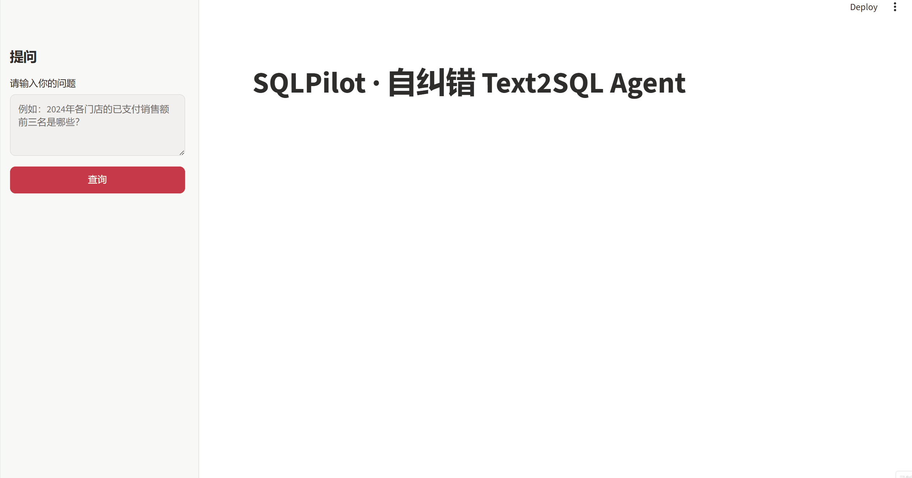
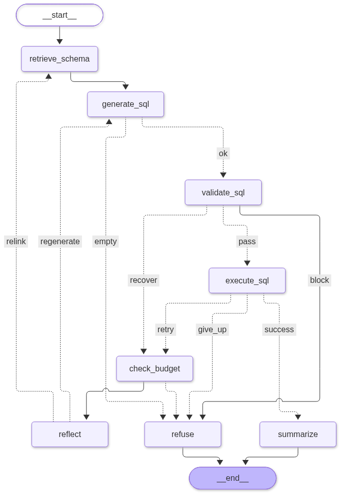

# SQLPilot · 自纠错 Text2SQL Agent

> 用自然语言问数据库，自动生成 SQL、执行、并在出错时**自纠错重试**的 Agent。
> LangGraph 状态机 + AST 安全网关 + 执行失败反思重试 + 全链路 Trace 可观测。

[](https://github.com/tearknee2/sqlpilot-text2sql-agent/actions/workflows/ci.yml)




---

## 核心特性

- **自纠错闭环**：生成的 SQL 若被校验/执行判失败，Agent 会 `reflect` 反思错误原因、重新生成 SQL（`UNKNOWN_COLUMN` 等可恢复错误），而不是一次失败就放弃。
- **AST 安全网关（SqlGuard）**：基于 `sqlglot` 语法树校验——只允许单条 `SELECT`、表白名单、**禁止 DDL（建/删/改表，如 CREATE/DROP/ALTER）与 DML（改数据，如 INSERT/UPDATE/DELETE）**；配合**只读数据库账号**形成软件层 + 数据库层**双保险**。
- **全链路 Trace**：每一步 `retrieve/generate/validate/reflect/execute/summarize` 都写入结构化 Trace（token 用量、错误 kind、耗时），UI 可折叠查看。
- **诚实评测方法**：10 次重复取区间 + 逐题稳定性分析，如实标注小样本局限。

---

## Quick Start（3 条命令）

```bash
git clone https://github.com/tearknee2/sqlpilot-text2sql-agent.git
cd sqlpilot-text2sql-agent
cp .env.example .env        # 填入 LLM_API_KEY 等（Windows PowerShell: Copy-Item .env.example .env）
docker compose up -d --build
```

打开 <http://localhost:8501> 即可提问；后端 API 在 <http://localhost:8000/docs>。

> 没有 API Key？设 `DEMO_OFFLINE_MODE=true` 可用**预录 Trace 离线体验 UI**（加载 `web/demo_trace.json`，**确实无需调用任何模型**）。

---

## 架构与工作流



**Agent 状态机（LangGraph）**：`retrieve_schema → generate_sql → validate_sql → execute_sql → summarize`

- **校验失败可恢复**：`validate_sql 失败 → check_budget → reflect → 重新 generate_sql`
- **执行失败可重试**：`execute_sql 失败(可恢复错误) → check_budget → reflect → 重试`
- **reflect 之后的分支**：若需重新检索（如列/表名错）则回到 `retrieve_schema`（relink）；否则直接回到 `generate_sql`（regenerate）
- **终止**：SQL 不安全(block) / 无 SQL / 超预算 → `refuse`

> ⚠️ `web/graph.png` 由 LangGraph 自动导出，可能未完整渲染 `route_reflect` 的 relink/regenerate 两条分支；**完整拓扑以 `sqlpilot/agent/graph.py` 为准**。

**错误分类（以代码 `agent/errors.py` 为准）**：
- **可恢复（触发纠错重试）**：`UNKNOWN_COLUMN`、`UNKNOWN_TABLE`、`TYPE_MISMATCH`、`SYNTAX`、`OTHER`
- **终止/特殊状态（不重试）**：`BLOCKED`(安全拦截)、`QUERY_TIMEOUT`(超时)、`EMPTY_RESULT`(结果为空)、`ROW_TRUNCATED`(结果截断)
  > 注：`EMPTY_RESULT` 不一定是错误——空结果可能是正确答案；此处是代码中的"特殊处理状态"分类。

**SqlGuard 说明**：AST 校验用于拦截非 SELECT 语句与越权表访问；**自动添加 `LIMIT` 是限制结果集规模、降低大结果集返回和资源消耗**（LIMIT 并不保证数据库只扫描少量行，它只限制返回行数）。

---

## 评测数据（重点）

> **诚实声明**：dev 仅 16 道可评分题；LLM 即使在 `temperature=0` 下仍有**题级生成抖动**。所有结论以 **10 次重复的区间 + 逐题稳定性**为准，**不做显著性检验**（16 题小样本做统计检验功效很低，故不强行做），不将小样本差异夸大为普遍优势。

### 1. 消融实验（dev 16 题 · 10 次重复 · deepseek-chat, temperature=0）

| 组 | 配置 | 10 次平均 | 区间 | 单次参考 |
|---|---|---|---|---|
| **G2** | top-k 检索 + 自纠错（完整版） | 91.25% | 87.5% ~ 93.8% | 15/16 |
| **G1** | top-k 检索 + 无纠错 | 89.4% | 87.5% ~ 93.8% | 15/16 |
| **G0** | 全量表(30张) + 自纠错 | 93.75% | 87.5% ~ 100% | 14/16 |

**区间重叠声明**：三组 10 次重复的区间存在较大重叠（87.5%~100%）。结合逐题稳定性，目前**没有足够证据证明检索策略或自纠错机制在这 16 道题上带来稳定、明确的准确率提升**。波动可能来自模型生成、SQL 执行、结果比较等多因素（G0 用全量表、G2 用 top-k，两者不仅检索开关不同，上下文信息量也不同）。**本实验不进行显著性断言，如实呈现观察结果。**

### 2. 逐题稳定性分析（10 次/组 · 核心发现）

| 题 | G0 | G1 | G2 | 性质 |
|---|---|---|---|---|
| 其余 14 题 | 10/10 | 10/10 | 10/10 | **稳定对**（模型已掌握） |
| **E05** | 3/10 | **0/10** | **0/10** | **G1/G2 稳定失败；G0 3/10 不稳定** |
| **E16** | 7/10 | 3/10 | 6/10 | **三组均抖动** |

- **E05**：G1/G2 十次全错（稳定失败，模型固定缺陷——多 SELECT `store_id` / 漏 `store_name` 的列选择粒度错误）；G0 3/10（全量表偶见好转但仍不稳定）。属**静默语义错**，DB 不报错、执行期纠错抓不到。
- **E16**：不同运行中 SQL 写法、排序细节或输出列顺序存在变化，可能与模型生成波动及结果比较规则共同有关。**目前尚不能完全归因于模型能力或比较器**，需结合逐次 SQL/执行结果进一步分析。

### 3. 压力集（30 题 · qwen2.5-coder:7b 本地 Ollama · **仅 1 轮**）

| 指标 | 值 |
|---|---|
| 触发纠错题数 / 总题数 | 11 / 30 |
| 触发率 | **36.7%** |
| 挽回题数 / 触发题数 | 5 / 11 |
| **挽回率** | **45.5%** |

> 单轮机制观察，**不代表模型长期稳定性**；A 类 5 题证明"本次运行中完成纠错并成功"，**不代表整体自纠错成功率就是 45.5%**。

**按行为分层归因（A/B/C/D）**：

| 类别 | 含义 | 题号示例 | 证明什么 |
|---|---|---|---|
| **A：触发并挽回** | 错 SQL → 纠错重试 → 成功 | S02,S09,S10,S22,S29 | **自纠错能力的直接证明** |
| **B：安全拒答** | 题面范围外 → 直接拒答，不瞎编 | S01,S03,S04,S05,S06,S27 | 幻觉控制 / 范围外闸门 |
| **C：触发但未挽回** | 触发纠错但错误无法修复（如 MySQL 不支持的函数） | S07,S08,S11,S18,S23,S26 | 纠错边界 |
| **D：正常解答** | 一次写对 | 其余 | 模型基础能力 |

> **"不触发"不等于系统差**：B 类拒答（安全边界）和 D 类一次答对（基础能力）都是正确行为。**纠错的直接证据 = A 类 5 题。**

完整评测报告见 [`eval/report.md`](eval/report.md)。

---

## 设计取舍（ADR）

> ADR = Architecture Decision Record（架构决策记录）：记录"为什么这样设计、放弃了什么"。

- **结果集比对 > LLM-as-Judge**：用 `compare.py` 对 SQL 执行结果做确定性比较（列对齐、浮点容差、有序结果比较），避免引入额外裁判模型的主观判断。**注意边界**：无序结果、`ORDER BY` 并列值、列顺序变化等情形需明确比较规则（E16 正是暴露了这类边界）。
- **放弃多轮对话 / 只做单轮问答**：聚焦"单问题 → 单 SQL → 单结果"的高确定性链路，不引入对话状态复杂度。
- **UI 走 HTTP 不直连 Service**：分层架构，凭据只在后端，UI 可独立部署。
- **执行期纠错只治"执行错"，不治"语义错"**：自纠错覆盖 DB 报错类（列/表/语法/类型），对"跑通但业务口径错"的静默语义错无能为力——**这是当前架构的已知边界**（下一步方向：Semantic Plan 语义验证层）。
- **Prompt / Catalog 冻结**：`PROMPT_VERSION = v2.0-final`，评测后冻结，保证可复现。

---

## 本地开发与测试

```bash
conda activate sqlpilot        # 或你的 venv
pip install -r requirements.txt

# 单元测试（--ignore=tests/test_api.py：该文件需要连真实 MySQL，CI 环境无 DB 故跳过）
pytest -q tests/ --ignore=tests/test_api.py

# 评测
python -m sqlpilot.eval validate                                  # 校验评测集
python -m sqlpilot.eval run --split dev --group G2                # 主集一组
python -m sqlpilot.eval run --stress --runs 1 --group G2          # 压力集

# 前后端分离启动（不走 Docker）
python -m uvicorn sqlpilot.api:app --host 127.0.0.1 --port 8000   # 终端1：后端
streamlit run web/streamlit_app.py                                # 终端2：前端
```

**代码结构**：
```
sqlpilot/
  agent/        # LangGraph 状态机 (graph.py)、回退循环 (loop_fallback.py)、prompts.py
  guard/        # AST 安全网关 SqlGuard
  tools/        # MySQL 执行器（只读、超时、限额）
  schema/       # catalog + 检索器 (schema linking)
  schemas/      # API 的 Pydantic 请求/响应模型
  eval/         # 评测引擎 (runner.py)、数据模型、数据集(dataset/)、种子(_seeds/)
  observability/# Trace 写入/回放
  config.py     # pydantic-settings 配置
  api.py        # FastAPI 端点
  service.py    # 查询服务入口
data/           # 建表 SQL、seed 脚本
web/            # Streamlit UI + graph.png + demo_trace.json
tests/          # 单测 + 纠错链路冒烟测试
eval/           # 评测报告产物 (report.md 等)
```

**实验复现信息**：模型 `deepseek-chat`(temperature=0) / 压力集 `qwen2.5-coder:7b`(本地 Ollama) / 数据库 MySQL 8.0 / 数据集哈希 `ab9c1143...c65bb0` / commit 见仓库历史。

---

## 录制 Demo GIF（维护者）

- 优先展示**自纠错闭环**（错 SQL → `UNKNOWN_COLUMN` → `reflect` → 重跑成功），这是本项目区别于普通 Text2SQL 的核心。
- 用真实运行、可复现的 Trace，不伪造。保存为 `web/demo.gif`。
- 录制环境建议：UI 连接可稳定触发纠错的模型（如本地 qwen2.5-coder），演示流程 20~30 秒。
